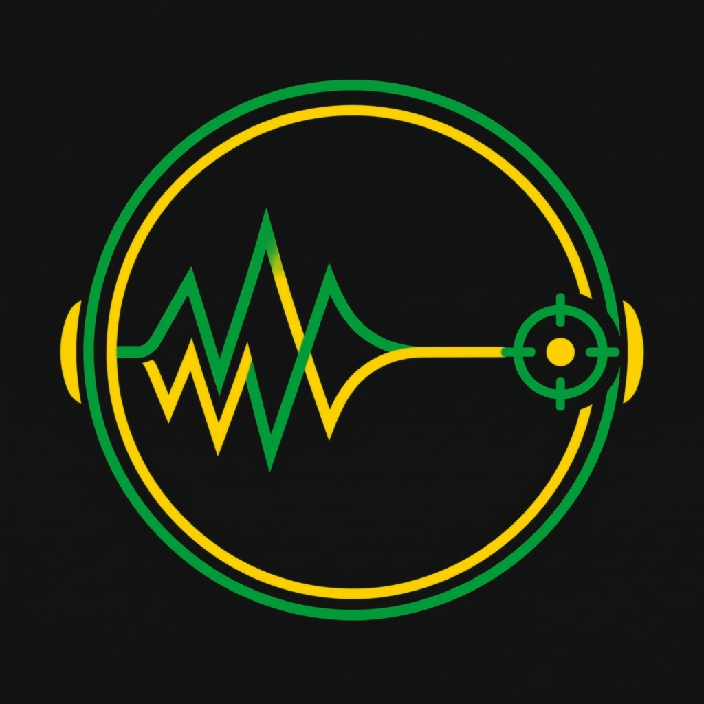

<h1> AutoVybz</h1>

**One tap. 10 seconds. Your speaker, tuned to your room.**

🌐 **[andrexthedev.github.io/AutoVybz](https://andrexthedev.github.io/AutoVybz/)** – hear the interactive before/after demo & roast your speaker 🔥

[](https://github.com/AndrexTheDev/AutoVybz/actions/workflows/ci.yml)
[](LICENSE)
[](#building)

AutoVybz is a GPL-3.0 Android app that **automatically calibrates external
loudspeakers** (Bluetooth, AUX, USB, HDMI) to your room with the phone's microphone — and then runs the
correction system-wide through the proven [Equalizer314](https://github.com/bearinmindcat/Equalizer314)
engine (DynamicsProcessing, 10-band PEQ, multiband compressor, limiter). The Alpha uses a deliberately
limited Free tier and an optional supporter Pro unlock; there is no account, no tracking and no ad SDK.
The permanent bottom banner in this build is an in-app placeholder and Pro entry point.

> Status: **0.2.0-alpha** – Free/Pro and on-device beta test build. Build with Android Studio / Gradle (see below).

## Free & Pro (Alpha)

- **Free with the permanent banner:** every feature family remains usable, but only **one saved profile**
  (counted over AutoVybz calibrations only – presets from the inherited studio screens do not consume it),
  **one measurement position**, safe default measurement/mic settings and internal presets.
- **7-day Pro trial:** starts automatically after the first successful calibration (or manually in the paywall).
- **Pro:** unlimited profiles, precise **3-position** measurements, expert measurement/mic/custom-target
  settings and external **APO / PEQ JSON / REW CSV** exports.
- **Prices and payment:** US$1.99 for 30 days, US$19.99 for 365 days or US$99 lifetime. The Alpha accepts
  only SOL, BTC or ETH to the project addresses below, then activates locally from the TXID. Payments are
  reconciled manually, there is no auto-renewal, and no Google Play services are required (GrapheneOS-friendly).

## Features

- **Sound screen (start page)** – one ring switches the system-wide EQ on/off (A/B while music plays),
  a 3-step guide on first start, your **speaker profiles** (one per calibrated speaker, e.g. Bluetooth box at
  home vs. party speaker outdoors) and **14 sound styles** in 5 groups:
  *Basis* (Pure) · *Beats & Bass* (Hip-hop & R&B, Reggae & dancehall, Afrobeats, Latin, Electronic) ·
  *Band & stage* (Rock, Pop, Live & concert) · *Natural & acoustic* (Jazz & acoustic, Classical) ·
  *Situations* (Podcast & speech, Party outdoors, Quiet listening). Styles are gentle curves (≤ 4 filters,
  ≤ ±6 dB) layered **on top of** the calibration, with a strength slider (default 70 %) and a live curve.
  Pre-gain is recomputed for every combination, so nothing can clip.
- **Studio** – everyday fine-tuning: bass/treble shelves (±6 dB), volume protection (limiter), A/B switch,
  speaker profiles (apply/delete); the expert tools (10-band PEQ, compressor, measurement & mic settings)
  one level deeper.
- **Intro** – the animated AutoVybz logo on every cold start (1080x1920, 60 fps, 8.2 s: `tools/intro/make_intro.sh`
  rebuilds `res/raw/avz_intro.mp4` from `branding/intro/Intro1.mp4` with motion interpolation, a 3x lanczos + CAS
  upscale and fades to the brand slate); silent by design, tap to skip, skipped automatically when the system has
  animations switched off.
- **1-click wizard for everyone** – big "Calibrate speaker" button, safety check, live mic level, result graph.
- **Measurement**: exactly 10 s stimulus = room-noise capture + periodic pink noise + logarithmic sine sweep
  20 Hz – 20 kHz; Kirkeby-regularised deconvolution, automatic latency detection (Bluetooth-safe),
  sweep/noise cross-check, SNR per 1/3 octave, clipping / low-signal warnings.
  The capture path negotiates its sample rate with the device (48 kHz, else 44.1 kHz – no hidden
  resampling), derives the recording tail from the latency budget instead of guessing it, removes the
  microphone's DC offset, crossfades sweep and pink-noise results by SNR and flags a response whose latency
  exceeds the search window. Stage by stage: [docs/AUDIO_PIPELINE.md](docs/AUDIO_PIPELINE.md);
  what comes next (measured THD, true peak, room decay, a verification pass) with the numbers behind it:
  [docs/AUDIO_ROADMAP.md](docs/AUDIO_ROADMAP.md).
- **Capture path**: Oboe (C++, AAudio/OpenSL) full-duplex with `UNPROCESSED` input, fallback
  `VOICE_RECOGNITION` → `MIC`; Java `AudioRecord/AudioTrack` fallback if the native engine fails.
  Native C++ FFT via JNI, Kotlin FFT fallback.
- **Mic compensation**: JSON database keyed by `Build.MANUFACTURER` / `Build.MODEL`
  (estimated MEMS archetypes – see [docs/MIC_PROFILES.md](docs/MIC_PROFILES.md)), Pro: USB measurement mic
  with calibration file (UMIK-style) or manual offset profile.
- **Dynamic smoothing**: 1 octave in the sub/bass → 1/3 octave from ~320 Hz (Pro: fine / strong).
- **Targets**: Smart (gentle bass lift, default), Neutral/Flat, Bass Boost, Harman/Loudness (analytic
  approximation), Custom (bass/treble/tilt).
- **Target inversion**: 5 or 10 parametric filters (default 10), bass roll-off detection + excursion guard
  (never boosts bass the speaker can't play), max boost / cut limits, automatic negative pre-gain +
  Equalizer314 limiter as anti-clipping.
- **Presets**: auto-named `AutoVybz_<device>_<yyyy-MM-dd>` (editable), saved into the normal Equalizer314
  preset list, activated with one tap. A calibration keeps its full measurement, so it can be re-fitted,
  exported or re-applied later; sound styles are layered on top and the pre-amp is recomputed every time, so
  nothing clips. Storage scopes, plan rules and the limiter policy:
  [docs/PRESETS_AND_LIMITS.md](docs/PRESETS_AND_LIMITS.md). Every failure the user can see is one complete,
  translated sentence with the English engine message only as a labelled technical detail:
  [docs/ERRORS_AND_MESSAGES.md](docs/ERRORS_AND_MESSAGES.md).
- **Export**: Equalizer APO / Peace / AutoEq `ParametricEQ.txt`, parametric EQ JSON, REW-importable CSV,
  internal `.avz.json` (curves + filters + metadata).
- **Expert tools** (from the Equalizer314 engine, restyled): 10-band PEQ graph, multiband compressor, limiter,
  measurement & mic settings.
- **Outdoor / party mode** – one tap in the wizard: max +3 dB boost (preserves loudness), ground-reflection
  notches ignored (1-octave median rule), per-frequency SNR gating (wind, traffic, birds are not "corrected"),
  wind / unsteady-noise / Bluetooth-dropout detection with "repeat this position", 3 positions recommended,
  limiter always on, full screen brightness for sunlight. Full failure-mode analysis with simulation numbers:
  [docs/OUTDOOR.md](docs/OUTDOOR.md).
- **Help** with step-by-step phone placement guide; **About** with credits and crypto donate dialog.
- **Design "Vybz Slate"** – the colours of the logo: slate `#1E262D`, neon green `#1EED61`, gold `#FCD207`;
  typeface Outfit (SIL OFL 1.1); dark-only (Dark / Black). Brand rings and line icons are drawn for AutoVybz.
  The inherited engine screens were moved from neutral grey to slate with
  [`tools/branding/retheme_inherited.py`](tools/branding/retheme_inherited.py) (guarded by `InheritedPaletteAuditTest`).

## Measurement tips

1. Connect the external speaker (headphones and the phone's own speaker are blocked on purpose).
2. Phone at the listening position, ear height, bottom mic towards the speaker, 1–2 m away, not hand-held.
3. Normal listening level on the speaker; AutoVybz sets media volume to ~70 % (restored afterwards).
4. Quiet room; disable Dolby Atmos / sound effects / speaker-app EQ. The AutoVybz EQ pauses itself.
5. Outdoors / party: choose **Outdoors · Party**, party level but not maximum, phone 2–4 m away at ear height
   (not on the ground), mic out of the wind, 3 positions spread over the dance area – see
   [docs/OUTDOOR.md](docs/OUTDOOR.md).

## Building

Requirements: Android Studio (AGP 8.2, Kotlin 1.9.20), JDK 17–21, Android SDK 36, **NDK 27.2.12479018**,
CMake 3.22.1.

```bash
./gradlew testDebugUnitTest   # JVM unit tests (DSP, fitter, exports, mic DB, routing)
./gradlew assembleDebug
tools/native/host_check.sh    # optional: FFT vs. DFT + Oboe/JNI syntax check on the host
python3 tools/micdb/generate_mic_profiles.py   # regenerate the mic profile DB
python3 tools/branding/generate_icons.py       # regenerate launcher icons from branding/
```

CI (`.github/workflows/ci.yml`) builds and tests every push. Releases: push a tag `AutoVybz-v<versionName>`
with the secrets `AUTOVYBZ_KEYSTORE_BASE64`, `AUTOVYBZ_STORE_PASSWORD`, `AUTOVYBZ_KEY_ALIAS`,
`AUTOVYBZ_KEY_PASSWORD` (optional variable `AUTOVYBZ_RELEASE_CERT_SHA256`).

## Architecture

```
app/src/main/java/com/andrexthedev/autovybz/
  measurement/dsp     stimulus, FFT, smoothing, analyzer        (pure Kotlin, unit-tested)
  measurement/eq      biquads, targets, fitter, AutoEQ renderer (pure Kotlin, unit-tested)
  measurement/mic     mic profiles, calibration-file parser, DB loader
  measurement/audio   Oboe/JNI + Java engines, route check, volume guard, EQ bypass
  measurement/        MeasurementController (orchestration)
  preset/, export/    AutoVybz preset model, Equalizer314 pool bridge, exporters
  sound/              sound styles, composer (calibration + style + tone), persistence
  premium/            Free/Trial/Pro policy + local TXID-hash persistence (no billing SDK)
  ui/                 Jetpack Compose: sound (home), wizard, studio, premium, intro, help, about/donate, theme
app/src/main/cpp/autovybz/   C++17 Oboe full-duplex engine + FFT + JNI
app/src/main/java/com/bearinmind/equalizer314/   upstream Equalizer314 (classic Views)
site/                landing page (GitHub Pages, see site/README.md)
```

## Credits & license

AutoVybz by **AndrexTheDev** (hippie.highho@gmail.com) is a fork of
**[Equalizer314](https://github.com/bearinmindcat/Equalizer314) by bearinmindcat** and, like upstream,
licensed under the **GNU GPL v3.0** – see [LICENSE](LICENSE) and [NOTICE.md](NOTICE.md).
The original upstream README is kept in [docs/UPSTREAM_README.md](docs/UPSTREAM_README.md).

## Support & Pro

Use the in-app AutoVybz Pro screen for the Alpha unlock, or support the project with one of the three
project crypto addresses:

| Coin | Address |
|---|---|
| SOL | `79KsqtJJdhKFJ9woxnYgtf3nq7HxQveafWBCtC3mxWi8` |
| BTC | `bc1qeqzrlfg3edrydk4s0hecakc82gp26n5p7hkc7f` |
| ETH / EVM | `0xBC3fab34f69bc9f6661608C3FB36dDdC313C42F7` |
